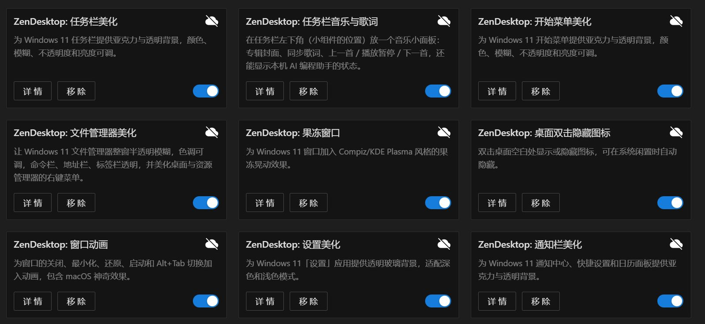
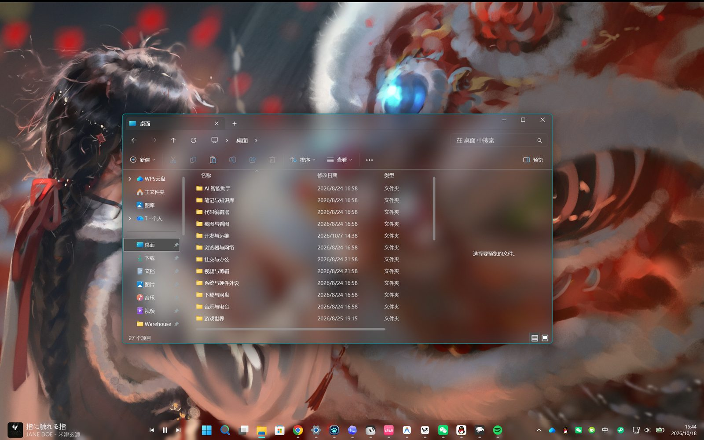
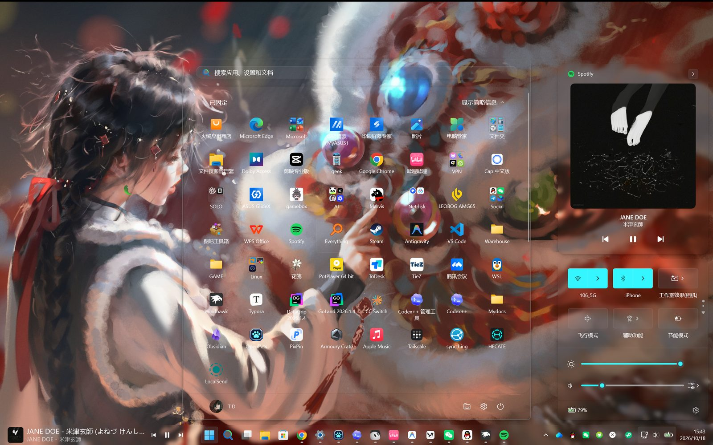

> CW桌面美化（CW Desktop）
> 一套 GPL-3.0 的 Windows 11 桌面美化整合包：整合自多个开源 Windhawk 模组项目，并加入三个汉化社区模组，原作者见各 mod 说明与 `optional\THIRD_PARTY_NOTICES.md`。

# CW桌面美化

CW桌面美化是一套 Windows 11 桌面美化 mod，运行在 [Windhawk](https://windhawk.net) 上：任务栏、开始菜单、通知栏和文件管理器统一换成透明玻璃风格，还能调任务栏高度与图标大小、滚动调音量、加 macOS 风格的 Dock 悬停动画。一共 9 个 mod，一键部署，所有效果都在 Windhawk 的设置页里调，改完立即生效。

## 效果预览

## Mod 介绍

8 个核心 mod 加 1 个可选 mod。**部署后全部默认关闭**，在 Windhawk「已安装的 Mod」里想用哪个开哪个。

### CW-任务栏美化

给 Windows 11 任务栏换上亚克力、模糊或透明背景，颜色、模糊、不透明度和亮度都可调。

* 默认主题「自定义玻璃」，可切换「液态玻璃」及 30 多款社区主题（Dock 风格、Windows 7、Sun Valley 等）。
* Win+X 菜单、托盘溢出面板、音量/亮度浮窗一起换成玻璃，没有额外描边，圆角与系统一致。
* 可选「最大化时加深背景」；可选任务栏空白处点击穿透。
* 任务栏高度、图标大小、按钮宽度均可调（含新版系统的小图标模式）；图标默认 24×24 是从 32×32 缩小的、会发糊，本模组可直接用原始清晰度的图标。
* 任务栏高度与图标大小部分原版：[Taskbar height and icon size](https://windhawk.net/mods/taskbar-icon-size)（m417z，GPL-3.0），本包汉化并整合。
* 基于 m417z 的 Windows 11 Taskbar Styler（GPL-3.0），Lanbo 深度修改版。

### CW-任务栏音量控制

在任务栏上滚动鼠标滚轮调节系统音量。

* 音量指示器可选 Windows 11 / 10 / 7 风格；滚动区域可限定任务栏、托盘或自定义区域。
* 按住修饰键可在屏幕任意位置滚动调音量；全屏时也能在任务栏位置滚动。
* 中键点击音量托盘图标切换静音。
* 原版：[Taskbar Volume Control](https://windhawk.net/mods/taskbar-volume-control)（m417z，GPL-3.0），本包汉化。

### CW-任务栏 Dock 动画

macOS 风格的任务栏图标悬停放大动画（Beta）。

* 三种动画曲线；相邻图标间距让位；空闲「呼吸」动画可调。
* 支持顶部任务栏镜像、排除系统按钮、标签栏兼容模式。
* 原版：[Taskbar Dock Animation](https://windhawk.net/mods/taskbar-dock-animation)（Ph0en1x-dev，GPL-3.0），本包汉化。
* 上游即标注 Beta：图标偶尔被任务栏裁切；不支持 StartAllBack。

### CW-开始菜单美化

给 Windows 11 开始菜单和搜索页换上亚克力与透明背景。

* 默认主题「自定义玻璃」，另有液态玻璃和多款社区主题。
* 可自定义开始菜单宽度和高度；应用名称可设为一直显示、隐藏或悬停显示；文件夹面板独立设置。
* 基于 m417z 的 Windows 11 Start Menu Styler（GPL-3.0），Lanbo 深度修改版。

### CW-文件管理器美化

让文件管理器整窗半透明模糊，命令栏、地址栏、标签栏透明，并美化右键菜单。

* 默认主题「CW 半透明」，色调可从 12 种预设里选，也可以自定义颜色。
* 适配浅色模式；改完设置，已打开的窗口立即刷新。
* 取代 ExplorerBlurMica，**不要两个同时用**。
* 基于 m417z 的 Windows 11 File Explorer Styler（GPL-3.0），Lanbo 深度修改版。

### CW-桌面双击隐藏图标

双击桌面空白处显示或隐藏图标，也可以在电脑闲置时自动隐藏。

* 双击空白处切换；双击文件、文件夹、快捷方式照常打开。
* 闲置自动隐藏默认开启，5 秒没有键盘鼠标操作就隐藏（3–60 秒可调）。
* Lanbo 原创。

### CW-通知栏美化

给通知中心、快捷设置（Win+A）和日历面板换上亚克力与透明背景。

* 默认主题「自定义玻璃」；浅色模式自动加白底并加深文字，对比度增强三档。
* 支持 24H2 起快捷设置换到 `ShellHost.exe` 的新系统。
* 基于 m417z 的 Windows 11 Notification Center Styler（GPL-3.0），Lanbo 深度修改版。

### CW-窗口动画（可选）

给窗口的关闭、最小化、还原、启动和 Alt+Tab 切换加入动画，包含 macOS 神奇效果。

* 11 种关闭动画、12 种最小化／还原／启动动画，每组可单独开关、选样式和时长。
* 可按进程名排除指定程序，常见游戏和反作弊程序已默认排除。
* 原作者 ReDrag（Windows Animations，MIT）；macOS 神奇效果来自 Abdullah Masood、Potassiumuncher。

### CW-右键菜单美化（可选）

把系统右键菜单换成 Breeze 的精致菜单：完整的经典菜单内容（属性、发送到、打开方式、全部 Shell 扩展项，没有 Win11 新菜单的「显示更多选项」两段结构），加上 Windows 11 亚克力材质、圆角与流畅动画；支持嵌入式 JavaScript 脚本 API，可以自己加菜单功能。

* **在 Windhawk 里启停，不用单独运行**：deploy 会先把 Breeze 工具（约 15 MB，绿色）复制到 Windhawk 目录旁的「CW右键菜单美化」文件夹；之后在 Windhawk 里打开「CW-右键菜单美化」模组开关即启动服务，关闭即停止。
* 服务保活：Breeze 进程异常退出时 2 秒内自动重启（可在模组设置里关闭）。
* 菜单外观直接在本模组「设置」页调：亚克力背景开关、菜单圆角/字号/项高/间距；首次启动按设置生成 `config.json`（位于 `%LOCALAPPDATA%\CWDesktop\breeze`，只补缺不覆盖）。
* 已知现象（上游）：退出服务时，少数场景可能触发一次资源管理器自动重启。
* 与本包的「CW-文件管理器美化」会同时作用到菜单：若同时开启且观感冲突，二选一即可。
* 上游 Breeze Shell 0.2.0（AGPL-3.0，std-microblock），二进制原样随包分发，署名与许可见该目录内 LICENSE.txt / NOTICE.txt。
* 与本包的「CW-文件管理器美化」会同时作用到菜单：已开启文件管理器美化的桌面玻璃菜单时，Breeze 的渲染可能与其叠加；如果观感冲突，二选一即可。
* 其他右键菜单相关开源项目参考（未随包分发）：ContextMenuManager（GPL-3.0，github.com/BluePointLilac/ContextMenuManager，整理增删菜单项，不改变外观）；Windhawk 模组 Explorer Context Menu Classic（恢复 Windows 10 经典菜单，与美化方向相反，仅作应急）。

## 下载

到 Releases 下载，**三个压缩包选一个**：

| 文件 | 适合谁 |
| --- | --- |
| `CWDesktop_OneKeyDeploy_v1.0.0.zip` | **大多数人选这个**。内含 Windhawk 联网安装器和全部 mod |
| `CWDesktop_OneKeyDeploy_v1.0.0_Offline.zip` | 网络差、Windhawk 总装不上的人。内含离线版 Windhawk 安装器，体积较大 |
| `CWDesktop_OneKeyDeploy_v1.0.0_Online.zip` | **已经装好 Windhawk** 的人。只含 mod 和脚本，最小 |

## 安装

需要 Windows 11 和管理员权限。

1.  把压缩包**完整解压**到任意文件夹（路径有空格或中文都可以），不要在压缩软件里直接运行。
2.  双击 **`deploy.bat`**，在权限提示里点「是」。没装 Windhawk 时，完整包和离线包会先打开包内的安装程序，装完自动继续；`_Online` 包请先从 windhawk.net 装好 Windhawk。
3.  窗口显示「一键部署完成」后按任意键关闭。
4.  打开 Windhawk →「已安装的 Mod」，以 `CW-` 开头的 mod **默认都是关闭的**。点进想用的 mod 打开开关，提示编译时按提示编译，几秒就好。
5.  在每个 mod 的「设置」页调效果，保存后立即生效。全部调好后建议重启一次电脑。

再次运行 `deploy.bat` 是安全的：已打开的 mod 保持打开，改过的设置不会被覆盖，只补上新增设置的默认值。

想在无人值守安装时直接打开可选 mod：`deploy.bat -Optional "windows-animations"`。

### 从旧版部署升级

直接运行 `deploy.bat`。旧 mod 的开关状态和设置会自动迁移到对应 `CW-` mod，旧条目会被清理；被移除的模组（设置美化、任务栏音乐与歌词、果冻窗口、灵动岛/胶囊媒体、独立任务栏高度与图标大小）会被自动卸载。

从 v4.1 升级的旧用户：先双击 **`tools/uninstall-ExplorerBlurMica.bat`**，再运行 `deploy.bat`。

## 卸载

双击 **`uninstall.bat`**，在权限提示里点「是」。它会先列出要删除的内容，确认后：

*   从 Windhawk 移除全部 CW- mod 和旧版 CW mod 及其设置。
*   删除开机自检计划任务（如果用 `-StartupCheck` 装过）。
*   询问是否删除 `%LOCALAPPDATA%\CWDesktop`（自检日志）。
*   询问是否重启资源管理器。

**Windhawk 本身不会被卸载**，你自己装的其他 mod 也不受影响。无人值守可以用 `uninstall.bat -Yes`（保留数据文件夹），加 `-RemoveData` 连数据文件夹一起删。

## 常见问题

*   **打开 mod 后没效果**：先确认 mod 已编译成功（Windhawk 里没有报错），再运行 `restart_explorer.bat` 或重启电脑。
*   **开机后文件管理器顶部不透明**：等几秒会自动补挂；还不行就在 Windhawk 里把「CW-文件管理器美化」关掉再打开。
*   **文件管理器不透明、命令栏发黑**：只用「CW-文件管理器美化」，不要同时开 ExplorerBlurMica。
*   **开机后托盘图标不透明**：在「CW-任务栏美化」的「高级：XAML 诊断冲突处理」里改成「阻止其他程序」。TranslucentTB 等同类软件会和美化 mod 抢 XAML 诊断，建议不要同时用。
*   **任务栏高度/图标大小调了没反应**：确认「CW-任务栏高度与图标大小」已编译；它与「CW-任务栏美化」可同时使用。
*   **Dock 动画图标被裁切**：降低「最大缩放」（130% 以下），或配合「CW-任务栏高度与图标大小」加高任务栏。
*   **滚动调音量没反应**：部分笔记本触控板不支持在任务栏上滚动，可改用「双指捏合」手势。

问题反馈：各 mod 说明里的「致谢与许可」列有原作者与原版链接；本整合包的改动见 `CHANGELOG_CW_v1.0.0.md`。

## 致谢与许可证

CW桌面美化以 GNU General Public License v3.0 发布。

*   Windhawk 和任务栏、开始菜单、通知中心、文件管理器的上游 Styler mod：m417z（GPL-3.0）。
*   任务栏高度与图标大小、任务栏音量控制：m417z（GPL-3.0）。
*   任务栏 Dock 动画：Ph0en1x-dev（GPL-3.0）。
*   窗口动画：ReDrag（MIT）；macOS 神奇效果：Abdullah Masood、Potassiumuncher。
*   套件深度修改与桌面双击隐藏图标：Lanbo（GPL-3.0）。
*   第三方署名与许可见 optional/THIRD_PARTY_NOTICES.md。

* * *

**English** — CW Desktop (CW桌面美化) is a Windows 11 desktop styling suite of 9 Windhawk mods, (deep modifications by Lanbo, GPL-3.0) with three localized community mods added (taskbar height & icon size, taskbar volume control, taskbar dock animation). Install: extract, run `deploy.bat` as administrator, enable mods in Windhawk (all installed disabled). Upgrading from older packages keeps toggles and settings (auto-migrated to new `cw-*` ids). Uninstall: `uninstall.bat`. License: GPL-3.0.
